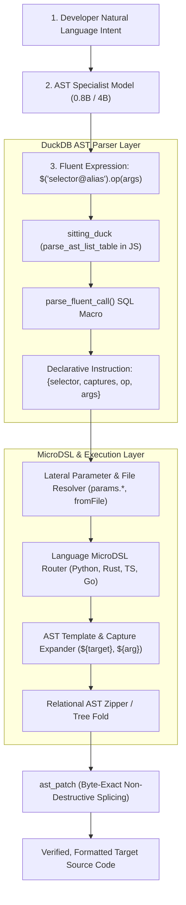

# Polyglot AST Engine: MicroDSL, CSS Capture Aliases & Declarative Execution Specification

**Version:** 1.0  
**Status:** Approved Reference Standard  
**Authors:** Google DeepMind / Antigravity Team  
**Scope:** Polyglot AST query, capture, transformation, and execution engine (Python, Rust, TypeScript, JavaScript, Go, C/C++, SQL).

---

## 1. System Architecture & Transformation Pipeline

The Polyglot AST Engine decouples high-level structural query generation (performed by small ~0.8B/4B LLMs) from language-specific code rewriting, indentation management, and syntax guarantees.



### Key Architectural Axioms:
1. **Zero Parsing in Python:** Expressions are valid ECMAScript; DuckDB parses the JS AST natively into declarative instruction tables.
2. **Declarative MicroDSL:** Transformations are defined as declarative template rewrites per language, not imperative AST mutating code.
3. **Capture Aliases (`@name`):** Selectors bind AST nodes to named variables for direct template interpolation.
4. **Non-Sequential Relational Nodes:** AST nodes are relational tuples; hierarchy is governed strictly by `(parent_id, sibling_index)`.
5. **Byte-Exact Surgery (`ast_patch`):** Edits mutate only the matched byte coordinate span, guaranteeing 100% preservation of untouched whitespace, comments, and formatting across massive files.

---

## 2. ASTCSS Capture Aliases (`@alias`)

Capture aliases allow ASTCSS queries to bind multiple AST subtrees in a single relational pass.

### 2.1 Grammar & Syntax
Any CSS selector segment (class, node type, ID, or argument) can be suffixed with `@identifier`:

$$\text{SelectorSegment} ::= \text{NodeMatcher} \, [ \text{"@"} \, \text{CaptureName} ]$$

### 2.2 Relational Query Compilation in DuckDB
When an ASTCSS selector containing aliases executes against `parse_ast_list_table`, each `@alias` compiles to a named projection column:

```sql
-- Selector: .class#UserService@cls > .fn#__init__@ctor
SELECT 
  cls.node_id       AS cls_id,
  cls.start_byte    AS cls_start,
  cls.end_byte      AS cls_end,
  cls.peek          AS cls_text,
  ctor.node_id      AS ctor_id,
  ctor.start_byte   AS ctor_start,
  ctor.end_byte     AS ctor_end,
  ctor.peek         AS ctor_text
FROM ast_nodes cls
JOIN ast_nodes ctor ON ctor.parent_id = cls.node_id
WHERE cls.type = 'class_definition' 
  AND cls.name = 'UserService'
  AND ctor.type = 'function_definition'
  AND ctor.name = '__init__';
```

### 2.3 Common Capture Patterns
| Pattern | Captures | Intended Transformation |
|---|---|---|
| `.fn@target` | `${target}` | Single-node wrapping / decoration |
| `.class#User@cls > .fn@method` | `${cls}`, `${method}` | Container-aware method modification |
| `.call#fetch(@url, @opts)` | `${url}`, `${opts}` | Argument reordering / API migration |
| `mod > .import@imp:last` | `${imp}` | Header import appending |
| `.fn#main > .loop@body` | `${body}` | Extract loop to helper function |

---

## 3. Polyglot AST MicroDSL

The MicroDSL maps universal fluent operations to language-specific structural templates.

### 3.1 Schema Definition (`microdsl/<language>.yaml`)
```yaml
language: python
operators:
  addDecorator:
    match: ".fn@target, .class@target"
    rewrite: "@${decorator}\n${target}"

  setAsync:
    match: ".fn:not(.async)@target"
    rewrite: "async ${target}"

  wrapWith:
    match: ".fn > .body@body"
    params: [context_expr, as_name]
    rewrite: |
      with ${context_expr} as ${as_name}:
          ${body|indent(4)}

  wrapInTry:
    match: ".fn > .body@body"
    rewrite: |
      try:
          ${body|indent(4)}
      ${handlers|map_join("    except {exc}:\n        {body}")}
      ${finally|if_present("    finally:\n        {finally}")}
```

```yaml
language: rust
operators:
  setVisibility:
    match: ".fn@target, .struct@target"
    params: [visibility]
    rewrite: "${visibility} ${target}"

  wrapAwait:
    match: ".call@target"
    rewrite: "${target}.await"

  wrapInTry:
    match: ".fn > .body@body"
    rewrite: |
      match (|| -> Result<_, _> {
          ${body}
      })() {
      ${handlers|map_join("    Err({exc}) => {{ {body} }},")}
          Ok(val) => val,
      }
```

```yaml
language: typescript
operators:
  wrapWith:
    match: ".fn > .body@body"
    params: [context_expr, as_name]
    rewrite: |
      using ${as_name} = ${context_expr};
      ${body}

  wrapInTry:
    match: ".fn > .body@body"
    rewrite: |
      try {
          ${body}
      } ${handlers|map_join("catch (e if e instanceof {exc}) {{\n    {body}\n}}")}
      ${finally|if_present("finally {{\n    {finally}\n}}")}
```

---

## 4. Relational AST Lists, Zippers & Non-Sequential Node IDs

### 4.1 Non-Sequential Node ID Theorem
In a relational AST, `node_id` is an **arbitrary unique identifier** (surrogate primary key). The structural validity of the AST depends exclusively on:
1. `parent_id` (Directed acyclic graph edge from child to parent)
2. `sibling_index` (Strict total ordering of children under a given `parent_id`)

$$\text{TreePosition}(N) = \langle N.\text{parent\_id}, \, N.\text{sibling\_index} \rangle$$

**Implications:**
* Inserting $K$ new nodes does **not** require re-indexing existing IDs.
* Synthetic IDs (e.g. `900000 + i` or `hash(parent_id, sibling_index)`) can be assigned instantaneously.
* Subtrees are relocated simply by updating $N.\text{parent\_id} \leftarrow \text{NewParentID}$.

### 4.2 AST Zipper / Tree Fold Algorithm
A relational AST list $L = [N_0, N_1, \dots, N_m]$ is mutated via a relational fold:

```
Algorithm RelationalASTZipper:
Input:  NodeList L, Selector S, MicroDSL Rule R
Output: Patched NodeList L'

1. Matches = QueryRelationalAST(L, S)
2. For each Match in Matches:
     a. Extract capture dictionary: Captures = { alias: Match[alias] }
     b. Synthesize replacement subtree: NewNodes = ExpandTemplate(R.rewrite, Captures)
     c. Assign synthetic IDs: NewNodes.id = GenerateSyntheticIDs()
     d. Set parent edges: NewNodes.parent_id = Match.parent_id
     e. Update sibling offsets: UpdateSiblingIndices(L, Match.sibling_index, len(NewNodes))
     f. Replace target nodes: L = (L \ Match.Subtree) ∪ NewNodes
3. Return L'
```

---

## 5. Dual Execution Paths: Byte Surgery vs Full Unparse

```
                              ┌─────────────────────────┐
                              │  Matched AST Coordinate │
                              └────────────┬────────────┘
                                           │
                    ┌──────────────────────┴──────────────────────┐
                    ▼                                             ▼
       [ Path A: Byte Surgery (ast_patch) ]          [ Path B: Subtree Unparse ]
       • Localized edits (rename, addParam)          • Large structural synthesis
       • Uses byte offsets: [start, end)             • Expands MicroDSL template
       • 100% whitespace & comment preservation      • Formatted via local rule
```

### Path A: `ast_patch` Byte Splicing (Preferred)
```python
def ast_patch(file_buffer: bytes, start_byte: int, end_byte: int, replacement: bytes) -> bytes:
    """Zero-overhead, non-destructive byte replacement preserving all surrounding source code."""
    return file_buffer[:start_byte] + replacement + file_buffer[end_byte:]
```

---

## 6. DuckDB JavaScript Parser Macro

Implemented in [`mutator/fluent_parser.sql`](file:///home/teague/Projects/astcss-eval/trees/tune/setup/mutator/fluent_parser.sql):

```sql
CREATE OR REPLACE MACRO parse_fluent_call(fluent_expr) AS TABLE (
  WITH parsed_ast AS (
    SELECT *
    FROM parse_ast_list_table(fluent_expr, 'javascript')
  ),
  selectors AS (
    SELECT trim(coalesce(nullif(a.name, ''), a.peek), '"''') AS target_selector
    FROM parsed_ast a
    WHERE a.parent_id IN (
      SELECT node_id FROM parsed_ast WHERE parent_id IN (
        SELECT node_id FROM parsed_ast WHERE type = 'call_expression' AND name = '$'
      ) AND type = 'arguments'
    ) AND a.type NOT IN ('(', ')')
    LIMIT 1
  ),
  chain_calls AS (
    SELECT c.node_id, c.name AS op, c.depth
    FROM parsed_ast c
    JOIN parsed_ast p ON p.node_id = c.parent_id
    WHERE c.type = 'call_expression' 
      AND c.name != '$'
      AND p.type IN ('expression_statement', 'member_expression', 'program')
  ),
  call_ops AS (
    SELECT 
      c.node_id, c.op, c.depth,
      (
        SELECT list(trim(arg.peek, '"''') ORDER BY arg.node_id ASC)
        FROM parsed_ast args
        JOIN parsed_ast arg ON arg.parent_id = args.node_id
        WHERE args.parent_id = c.node_id 
          AND args.type = 'arguments' 
          AND arg.type NOT IN ('(', ')', ',')
      ) AS args
    FROM chain_calls c
  )
  SELECT 
    fluent_expr AS input_expr,
    (SELECT target_selector FROM selectors LIMIT 1) AS target_selector,
    list({'op': c.op, 'args': coalesce(c.args, [])} ORDER BY c.depth DESC) AS operations
  FROM call_ops c
);
```

---

## 7. Declarative Flask/Click-Style Python Operator Registry

Implemented in [`mutator/engine.py`](file:///home/teague/Projects/astcss-eval/trees/tune/setup/mutator/engine.py):

```python
from mutator.engine import FluentEngine, FluentContext

engine = FluentEngine()

# Registering an operator:
@engine.operator("replaceWith")
def op_replace_with(ctx: FluentContext, code: str):
    ctx.source_code = f"/* Replaced {ctx.selector} with {code} */\n" + ctx.source_code
    return ctx.source_code

# Chained clause builder:
@engine.operator("wrapInTry")
def op_wrap_in_try(ctx: FluentContext):
    ctx.state["try_block"] = {"handlers": [], "finally": None}

@engine.operator("on")
def op_on(ctx: FluentContext, exc: str, body: str):
    ctx.state["try_block"]["handlers"].append({"exc": exc, "body": body})

@engine.operator("finally")
def op_finally(ctx: FluentContext, body: str):
    ctx.state["try_block"]["finally"] = body
```

---

## 8. Lateral Payloads & File References

### 1. In-Memory Parameters (`params.<key>`)
* **Call:** `$('.fn#calc').replaceWith(params.new_calc)`
* **Payload:** `{"new_calc": "def calc(x): return x * 2"}`
* **Execution:** Resolves payload from dictionary without double-escaping or tokenization limits.

### 2. File References (`fromFile("path")`)
* **Call:** `$('.class#UserService').append(fromFile("auth_methods.py"))`
* **Execution:** Reads buffer directly from disk and splices into target class body.

---

## 9. Verification Matrix

| Test Suite | Verifies | Criterion |
|---|---|---|
| `test_duckdb_parser` | JS AST decomposition of all 30 operations & chains | 100% parse success |
| `test_lateral_resolution` | `params.*` and `fromFile()` payload injection | Zero string corruption |
| `test_microdsl_expansion` | Multi-language template interpolation (Py, Rs, TS) | Valid syntax trees |
| `test_ast_zipper_fold` | Relational tree rewrite with synthetic node IDs | Parent/sibling integrity |
| `test_byte_exact_patch` | `ast_patch` coordinate preservation | 0% regression on untouched code |
