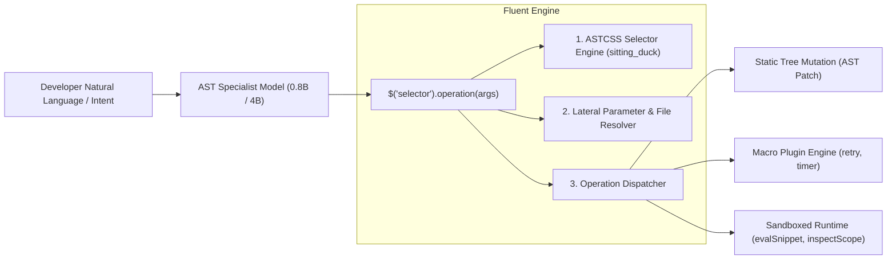

# Fluent AST Mutation & Runtime API Specification

**Version:** 3.0 (Polyglot Edition)  
**Status:** Approved Reference Standard  
**Authors:** Google DeepMind / Antigravity Team  

---

## 1. Executive Summary & Paradigm

The **Fluent AST API** is a declarative, jQuery-style language for querying, manipulating, inspecting, and executing Abstract Syntax Trees across polyglot codebases (Python, Rust, TypeScript, JavaScript, Go, C/C++, and SQL).



### Core Design Principles:
1. **Separation of Selector and Mutation:** Queries select target AST nodes with relational CSS precision; mutations apply language-aware structural transformations.
2. **Deterministic AST Execution:** Eliminates LLM indentation and syntax errors by performing transformations directly on AST nodes rather than raw text diffs.
3. **Small-Model Efficiency (0.8B Edge Routing):** A 0.8B model emits compact ~15-token routing calls (`$('.fn#save').retry(attempts=3)` or `$('.fn#calc').replaceWith(params.foo)`), delegating heavy AST construction and lateral payload grafting to the engine.
4. **Beyond Mutation (Runtime & Inspection Tools):** Supports non-mutation operations including sandboxed sub-process execution, lexical scope extraction, test coverage tracing, and breakpoint debugging.

---

## 2. Syntax & Formal Grammar

Every fluent expression conforms to the following grammar:

$$\text{FluentCall} ::= \text{SelectorInvocation} \,\, ( \text{"."} \, \text{OperationCall} )^+$$

$$\text{SelectorInvocation} ::= \text{"\$("} \, \text{ASTCSS\_Selector} \, \text{")"}$$

$$\text{OperationCall} ::= \text{Identifier} \, \text{"("} \, [ \, \text{ArgumentList} \, ] \, \text{")"}$$

### Invocation Examples:
* **Atomic Mutation:** `$('.fn#old_helper').rename("new_helper")`
* **Lateral Parameter Binding:** `$('.fn#calculate_tax').replaceWith(params.new_calc)`
* **File Embedding:** `$('.class#UserService').append(fromFile("auth_methods.py"))`
* **Chained Clause Builder:** `$('.fn#save').wrapInTry().on("KeyError", "return None").finally("db.close()")`
* **Runtime Scope Inspection:** `$('.fn#process > .loop').inspectScope()`
* **Sandboxed Execution:** `$('.fn#calculate_discount').evalSnippet({"price": 100, "customer_type": "vip"})`

---

## 3. ASTCSS Selector Reference

The selector component uses **ASTCSS**, picking exact AST subtrees across languages.

### Semantic Classes (Cross-Language)
| Class | Matches |
|---|---|
| `.fn`, `.func`, `.method` | Function and method definitions (lambdas included) |
| `.class`, `.struct` | Class, struct, trait, and interface definitions |
| `.mod` | File root / module namespace |
| `.call` | Function and method call expressions |
| `.member` | Attribute / field accesses (`a.b`) |
| `.import` | Module imports and include declarations |
| `.if` | Conditionals (`if`, `elif`, `else`, ternary expressions) |
| `.loop` | Iteration loops (`for`, `while`, comprehensions) |
| `.jump` | Control jumps (`return`, `break`, `continue`, `yield`, `raise`) |
| `.try`, `.catch`, `.throw` | Exception handling and error blocks |
| `.comment` | Line and block comments |
| `.var` | Variable declarations and assignments |

### Predicates & Filters
* `#name`: Matches exact identifier (e.g. `.fn#setup`, `.call#sleep`, `.class#User`).
* `[name^="prefix"]`: Starts with prefix (e.g. `.fn[name^="test_"]`).
* `[name$="suffix"]`: Ends with suffix (e.g. `.fn[name$="_handler"]`).
* `[name*="part"]`: Substring matching (e.g. `.class[name*="Service"]`).
* `[params=N]`: Function with exactly $N$ formal parameters (e.g. `.fn[params=3]`).
* `:has(S)`: Matches node containing a descendant matching selector $S$ (e.g. `.fn:has(.call#sleep)`).
* `:not(:has(S))`: Matches node containing no descendant matching selector $S$ (e.g. `.fn:not(:has(.try))`).

### Combinators
* `A B`: $B$ is a descendant of $A$ (e.g. `.class#User .fn`).
* `A > B`: $B$ is a direct child of $A$ (e.g. `.mod > .class`).
* `A + B`: $B$ is the immediate subsequent sibling of $A$ (e.g. `.comment + .fn`).
* `A ~ B`: $B$ is a subsequent sibling of $A$ (e.g. `.import ~ .var`).

---

## 4. Master Operations Catalog (30+ Operations)

### 4.1 Tree Structure & Movement
| Operation | Signature | Description | Example |
|---|---|---|---|
| `append` | `append(code)` | Appends code at the end of the node's body | `$('.class#User').append(params.method)` |
| `prepend` | `prepend(code)` | Prepends code at the start of the node's body | `$('mod').prepend(fromFile("header.py"))` |
| `insertBefore` | `insertBefore(code)` | Inserts code immediately before the target node | `$('.fn#main').insertBefore("DEBUG = True")` |
| `insertAfter` | `insertAfter(code)` | Inserts code immediately after the target node | `$('.import:last').insertAfter("import os")` |
| `replaceWith` | `replaceWith(code)` | Completely replaces the target node with new code | `$('.fn#old').replaceWith(params.new_impl)` |
| `remove` | `remove()` | Deletes the selected node from the AST | `$('.call#deprecated_log').remove()` |
| `moveTo` | `moveTo(target, options)` | Moves the selected node to a new container/anchor | `$('.fn#helper').moveTo('.class#Service', {pos: 'inside'})` |
| `addComment` | `addComment(text, pos?)` | Adds a comment (language comment syntax auto-injected) | `$('.fn#auth').addComment("Requires JWT", pos="before")` |

---

### 4.2 Declarations, Modifiers & Signatures
| Operation | Signature | Description | Example |
|---|---|---|---|
| `rename` | `rename(new_name)` | Renames the identifier across declaration and binding | `$('.fn#calc_total').rename("compute_sum")` |
| `addParam` | `addParam(name, default?, type?)` | Appends a parameter to a function signature | `$('.fn#fetch').addParam("timeout=5.0")` |
| `removeParam` | `removeParam(name)` | Removes a parameter by name from function signature | `$('.fn#fetch').removeParam("verbose")` |
| `setParamType` | `setParamType(name, type)` | Sets or updates parameter type annotation | `$('.fn#run').setParamType("retries", "int")` |
| `setReturnType`| `setReturnType(type)` | Sets or updates return type annotation | `$('.fn#run').setReturnType("bool")` |
| `addDecorator` | `addDecorator(expr)` | Attaches a decorator or attribute to a function/class | `$('.fn#get_user').addDecorator("@login_required")` |
| `removeDecorator` | `removeDecorator(expr)` | Removes matching decorator | `$('.fn#view > .decorator#cache').remove()` |
| `setAsync` | `setAsync(bool)` | Converts function between sync and async | `$('.fn#fetch').setAsync(true)` |
| `setVisibility`| `setVisibility(vis)` | Sets access modifier (`pub`, `private`, `export`) | `$('.fn#internal').setVisibility("pub")` |
| `addField` | `addField(field_def)` | Adds a field/property to a class or struct | `$('.class#User').addField("email: str = ''")` |
| `removeField` | `removeField(name)` | Removes a field by name | `$('.class#User > .field#temp').remove()` |
| `addImport` | `addImport(stmt)` | Adds an import statement to module head | `$('mod').addImport("import json")` |
| `ensureImport`| `ensureImport(stmt)` | Idempotent import addition (skips if already present) | `$('mod').ensureImport("from typing import Optional")` |

---

### 4.3 Expressions & Calls
| Operation | Signature | Description | Example |
|---|---|---|---|
| `wrapCall` | `wrapCall(fn_name)` | Wraps target expression as an argument to `fn_name` | `$('.call#calc').wrapCall("int")` |
| `chainCall` | `chainCall(method, *args)` | Chains a method call onto an expression | `$('.call#get_users').chainCall("filter", "active=True")` |
| `wrapAwait` | `wrapAwait()` | Prepends `await` / `.await` to an expression | `$('.call#fetch_data').wrapAwait()` |
| `addArg` | `addArg(expr, kw?)` | Appends a positional or keyword argument to a call | `$('.call#log').addArg("level=DEBUG")` |
| `removeArg` | `removeArg(name_or_idx)` | Drops argument from call expression | `$('.call#log').removeArg("verbose")` |
| `setReturn` | `setReturn(expr)` | Updates return expression in a jump statement | `$('.jump#return').setReturn("False")` |
| `setCondition`| `setCondition(expr)` | Updates predicate in conditional statement | `$('.if#check').setCondition("count > 0")` |

---

### 4.4 Refactoring & Control Flow
| Operation | Signature | Description | Example |
|---|---|---|---|
| `extractVariable` | `extractVariable(var_name)` | Extracts expression into a local variable assignment | `$('.call#compute_tax').extractVariable("tax_val")` |
| `extractFunction` | `extractFunction(fn_name, *params)` | Extracts block/loop into a separate helper function | `$('.fn#main > .loop').extractFunction("process_row")` |
| `addAssertion` | `addAssertion(assertion, msg?)` | Injects an assertion check | `$('.fn#test_case').addAssertion("len(res) > 0")` |
| `wrapWith` | `wrapWith(context_expr, as_name?)` | Wraps block in a `with` / `using` context manager | `$('.fn#load').wrapWith("open(path, 'r')", as_name="f")` |
| `wrapInTry` | `wrapInTry().on(exc, body)*.finally(body)?` | Wraps body in ordered try/catch/finally handlers | `$('.fn#save').wrapInTry().on("KeyError", "return None")` |

---

### 4.5 Macro Plugins
Macro plugins generate complex multi-node patterns deterministically from clean semantic intents:

* **`.timer(metric_name)`**: Injects start/stop latency measurement probes or `@time_it` decorator.
* **`.guard(condition, error_msg)`**: Inserts defensive fail-fast preconditions at the head of a function.
* **`.retry(max_attempts, delay, backoff)`**: Wraps call or function in an exponential-backoff retry loop.
* **`.memoize(cache_key)`**: Injects LRU/Redis caching decorator or local dictionary memoization.
* **`.rate_limit(calls_per_sec)`**: Attaches token-bucket rate limiter.
* **`.audit_log(event_type)`**: Emits structured security audit event upon function execution.
* **`.deprecated(reason, version)`**: Emits deprecation warnings or `@deprecated` attribute.
* **`.validate_schema(schema)`**: Validates function inputs against Pydantic / Zod / JSON Schema.
* **`.trace(span_name)`**: Injects OpenTelemetry distributed tracing spans.
* **`.fallback(default_value)`**: Injects graceful failure return on uncaught exceptions.

---

### 4.6 Secondary Runtime, Inspection & Verification Tools
| Tool | Signature | Return Value | Description |
|---|---|---|---|
| `evalSnippet` | `evalSnippet(inputs={...})` | `{status, result, stdout, stderr}` | Slices AST subtree, injects mock fixtures, executes in sandboxed sub-process |
| `dryRun` | `dryRun(context={...})` | `{result, state_diff}` | Simulated non-mutating execution |
| `inspectScope`| `inspectScope(filter?)` | `{params, locals, globals, imports}` | Resolves all visible symbol bindings at the node's coordinates |
| `freeVariables` | `freeVariables()` | `[var_name_strings]` | Discovers undeclared external identifiers required to run node |
| `capturedBindings` | `capturedBindings()` | `[closure_var_strings]` | Identifies parent scope variables captured by closures |
| `coveringTests` | `coveringTests()` | `[test_file_paths]` | Intersects AST span with coverage traces to find covering tests |
| `runTests` | `runTests()` | `{passed, failed, duration}` | Executes only the targeted unit tests covering matched nodes |
| `setBreakpoint` | `setBreakpoint(condition?)` | `{breakpoint_id, line}` | Injects DAP debugger breakpoint or `breakpoint()` statement |
| `traceCalls` | `traceCalls()` | `{call_count, timings}` | Attaches dynamic execution counter |
| `reformat` | `reformat(style='black'\|'prettier')` | `formatted_code` | Round-trip AST pretty-printing preserving outer indentation |
| `typeCheck` | `typeCheck()` | `{errors: [...]}` | Runs localized type checking diagnostics on the node |
| `backwardSlice` | `backwardSlice()` | `[affected_ast_nodes]` | Computes program slice of statements influencing target variable |

---

## 5. Lateral Payloads & File References

To avoid token bloat and escaping bugs when dealing with large code blocks, the Fluent API supports three binding mechanisms:

### 1. In-Memory Parameters (`params.<name>`)
```javascript
// Invocation with payload: { new_implementation: "def process(self):\n    ..." }
$('.fn#process_order').replaceWith(params.new_implementation)
```

### 2. Staged File References (`fromFile("path")` / `file("path")`)
```javascript
// Replaces or appends directly from a file buffer on disk:
$('.class#UserService').append(fromFile("src/auth_methods.py"))
$('mod').prepend(fromFile("license_header.txt"))
```

### 3. Template Interpolation (`template("name", {...})`)
```javascript
// Parameterized snippet interpolation:
$('.fn#api').wrapWith(template("auth_guard", { role: "admin", level: 2 }))
```

---

## 6. Programmatic Python & CLI Usage

### Python API Integration
```python
from mutator.runtime import evaluate_fluent_expression, eval_snippet_sandboxed, inspect_scope_at_line

# 1. Execute an AST Mutation with lateral parameters
source_code = open("service.py").read()
fluent_expr = "$('.fn#calculate_tax').replaceWith(params.new_calc)"
payload = {"new_calc": "def calculate_tax(amount): return amount * 0.08"}

new_code = evaluate_fluent_expression(source_code, fluent_expr, params=payload)

# 2. Inspect Scope at an AST coordinate
scope = inspect_scope_at_line(source_code, lineno=45)
print("Visible variables:", scope["locals"])

# 3. Sandboxed Evaluation of a Code Snippet
res = eval_snippet_sandboxed(
    "discount = price * rate\nprint(f'Discount: {discount}')",
    inputs={"price": 200, "rate": 0.15}
)
print("Execution output:", res["stdout"])
```

### Command-Line Interface (CLI)
```bash
# Query and mutate code directly from the terminal:
astcss -Q "$('.fn#old_helper').rename('new_helper')" service.py -o service_patched.py

# Inspect scope:
astcss -Q "$('.fn#process > .loop').inspectScope()" service.py

# Execute sandboxed snippet with JSON inputs:
astcss -Q "$('.fn#calc').evalSnippet(params.data)" service.py --params '{"data": {"x": 10, "y": 20}}'
```

---

## 7. Model Roles & Deployment Matrix

| Model Tier | Checkpoint | Primary Role | Hardware Footprint |
|---|---|---|---|
| **0.8B Specialist** | `fluent-0.8b` (fp16) | Fast IDE / Edge Dispatcher (30 Ops, Selectors, Lateral Parameters) | **1.6 GiB VRAM** / sub-10ms latency |
| **4B Specialist** | `fluent-4b` (NF4) | Generative Heavy Lifter (Complex Multi-Line Body Replacements) | **4.2 GiB VRAM** / ~30ms latency |
| **9B NPU Tier-5** | `t5-9b-mixed` (NF4) | Production Cloud / Enterprise NPU Suite Model | **8.5 GiB VRAM** |
